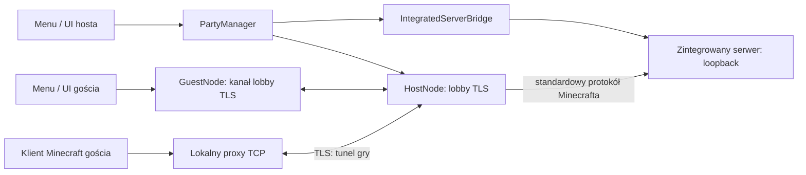
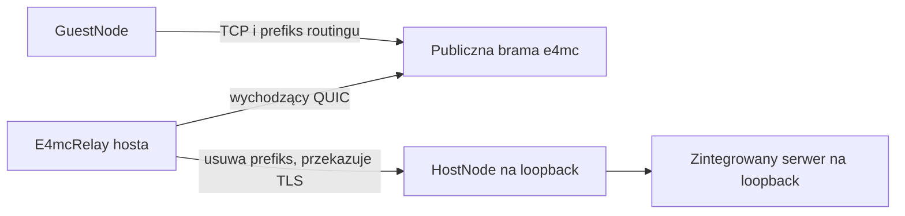

# Decyzja techniczna — aktualizacja 2026-11-16

W 0.5.0, po jawnym zaakceptowaniu zewnętrznego relaya przez użytkownika, domyślny Internet to publiczny e4mc QUIC/TCP. Warianty bezpośrednie opisane poniżej pozostają osobnymi opcjami. [Szczegóły integracji](E4MC_RELAY.md).

## Wersje i dostępność

Sprawdzone źródła: [Fabric Meta](https://meta.fabricmc.net/v2/versions/game), [Fabric Develop](https://fabricmc.net/develop/), [konfiguracja JDK](https://docs.fabricmc.net/develop/getting-started/setting-up), [projekt](https://docs.fabricmc.net/develop/getting-started/creating-a-project), [ekrany](https://docs.fabricmc.net/develop/rendering/gui/custom-screens).

Fabric wskazuje stabilne 26.3; dla tego zadania dostępne lokalnie są Minecraft 26.2, Loom 1.17.21, Loader 0.19.3, Fabric API 0.161.0+26.2, Gradle Wrapper 9.5.1 i pełny JDK 25.0.2. Dlatego skompilowany prototyp celuje w 26.2. Oficjalne nazwy metod i pól sprawdzono również przez `javap` w rzeczywistym JAR 26.2; nie korzystamy z wymyślonych nazw ani dawnych mapowań Yarn. Próby pobrania bibliotek z procesu kompilacji kończą się błędem DNS, a nawet lokalne gniazda są zablokowane. Port na 26.3 wymaga nowego zestawu zależności i weryfikacji accessorów.

## Dlaczego lobby nie jest światem

Host jest autorytetem lobby już w menu głównym. Połączenie sterujące TLS utrzymuje skład i poświadczenia niezależnie od serwera gry. Świat jest czasowym zasobem o losowym identyfikatorze. Goście używają drugiego, uwierzytelnionego połączenia TLS do przeniesienia strumienia Minecrafta. Zamknięcie świata usuwa ten zasób i tunele, ale nie kontrolny kanał Party. Przesyłanie chunków nie blokuje wiadomości lobby w jednej kolejce.

## Porównanie transportów

| Wariant | Dostępność i licencja | Zalety | Koszt / ograniczenia | Decyzja |
| --- | --- | --- | --- | --- |
| TCP + JSSE TLS 1.3 | Publiczne API JDK; bez nowej biblioteki do dystrybucji | Sprawdzona kryptografia, niezawodny strumień, przenośność Windows/Linux | Sam nie przechodzi NAT; wymaga osiągalnego hosta | Zaimplementowany rdzeń prototypu LAN |
| [ice4j](https://github.com/jitsi/ice4j) | Apache-2.0, implementacja Java projektu Jitsi | ICE, STUN, wybór i sprawdzenie par kandydatów | Nie stanowi samodzielnego, szyfrowanego i niezawodnego strumienia; potrzebne DTLS oraz transport niezawodny/backpressure; zależności wymagają audytu i testów JDK 25 | Preferowany kandydat do eksperymentu ICE, nie dołączony do moda |
| [webrtc-java](https://github.com/devopvoid/webrtc-java) | Wrapper Apache-2.0; JNI i biblioteki natywne, repo opisuje Windows i Linux | DataChannel oferuje niezawodny kanał; stos ICE/DTLS/SCTP już istnieje | Większa dystrybucja; różne architektury/ABI i licencje składników natywnych; integracja Fabric/JDK25 nieprzetestowana | Sensowny punkt odniesienia, bez automatycznego wyboru WebRTC |
| Własny niezawodny UDP | Brak nowej biblioteki | Kontrola pakietów i kolejek | Odtwarzanie kontroli przeciążenia, retransmisji, MTU, kolejności i zabezpieczeń to duże ryzyko | Nie implementujemy własnej kryptografii ani „pseudo TCP” jako skrótu |
| UPnP / NAT-PMP / PCP | Protokoły pomocnicze, nie pełny transport | Router może sam otworzyć czasowe mapowanie | Niekoniecznie dostępne, nie pokonuje zewnętrznego CGNAT; wymaga odnowienia i usunięcia dzierżawy | UPnP zaimplementowane w 0.4.0; PCP/NAT-PMP pozostają planem |

ice4j informuje, że implementacja pseudo TCP została przeniesiona do osobnego projektu; nie zakładamy, że jest częścią aktualnego API. Wybór konkretnej biblioteki niezawodnego transportu nastąpi po sprawdzeniu współpracy z ICE i testach strat/przeciążenia. Licencje opisano jako informacje techniczne z repozytoriów, bez włączania tych bibliotek do wydania.

## Sygnalizacja bez backendu

Bezpośrednie `mp2:` koduje wersję, UUID lobby, kandydatów IPv4, port, odcisk certyfikatu SHA-256, sekret 256 bitów i wygaśnięcie. Relayowe `mp3:` koduje te same poświadczenia i przydzieloną domenę e4mc, bez adresów hosta. Nie ma własnego katalogu lobby ani krótkich kodów; relay korzysta z publicznego brokera i DNS e4mc. Kod jest dłuższy, prywatny i wymieniany dowolnym zaufanym komunikatorem. Format binarny ma ścisłe limity i nie używa deserializacji obiektów Javy.

Przyszłe ICE będzie wymagało oferty hosta oraz odpowiedzi gościa dla każdej pary; użytkownik zaakceptował taki przepływ. Odpowiedź musi związać kandydatów gościa z UUID oferty, jednorazowym wyzwaniem, kluczem i terminem ważności. Host wkleja odpowiedź i obie strony wykonują connectivity checks z tych samych gniazd, z których zebrały kandydatów. Należy osobno uwierzytelnić klucze DTLS/transportu. Sam hasz certyfikatu w niezaufanym kanale nie potwierdza tożsamości znajomego.

STUN ustala obserwowany adres gniazda; nie jest rejestrem lobby, sygnalizacją ani gwarancją połączenia. Nie można użyć mapowania UDP odkrytego przez STUN jako adresu nasłuchu TCP. Dla ICE-UDP potrzebny jest cały stos przenoszący niezawodny strumień. Przy niektórych parach symetrycznych NAT, CGNAT lub zaporach bez relaya połączenie nie powstanie. Zgodnie z priorytetem projektu nie uruchamiamy obowiązkowego TURN i w takim przypadku trzeba zgłosić niedostępność bezpośredniej drogi.

Źródła protokołów: [ICE RFC 8445](https://www.rfc-editor.org/rfc/rfc8445), [STUN RFC 8489](https://www.rfc-editor.org/rfc/rfc8489), [Trickle ICE RFC 8838](https://www.rfc-editor.org/rfc/rfc8838), [PCP RFC 6887](https://www.rfc-editor.org/rfc/rfc6887), [NAT-PMP RFC 6886](https://www.rfc-editor.org/rfc/rfc6886).

## Podział kodu

| Odpowiedzialność | Implementacja |
| --- | --- |
| Party Manager | `PartyManager` — operacje asynchroniczne, generacje anulowania, publiczny stan UI |
| Lobby State | `LobbyModel`, `LobbyState` — autorytet hosta i niemodyfikowalne snapshoty |
| Network Transport | `HostNode`, `GuestNode`, `SocketPipe`, `TlsIdentity`, `Wire` w niezależnym `party-core` |
| Connection Negotiation | `DirectCandidates`, `InternetExposure`, `E4mcRelay`, `Invite` — jawny wybór bezpośrednio / UPnP / relay; brak atrap ICE |
| Integrated Server Bridge | `IntegratedServerBridge`, dwa accessory Mixin ściśle dla 26.2 |
| Client Session Manager | `ClientSessionManager` — epoki światów, loopback proxy, standardowy ConnectScreen, powrót do Party |
| Party UI | `PartyScreen` i zdarzenia Fabric Screen API, stronicowanie listy |
| Configuration | `PartyConfig` — wyłącznie preferencje bez danych połączenia |
| Localization | `assets/minecraftparty/lang/en_us.json`, `pl_pl.json` |

Operacje TLS, DNS (przy przyszłych adapterach), odczyt gniazd i tunelowanie odbywają się poza wątkiem renderowania. Stan UI trafia przez executor Minecrafta. Listener vanilla jest zakładany na wątku serwera, a jego port 0 odczytujemy z rzeczywiście zbindowanego kanału Netty. Nie rezerwujemy portu osobnym gniazdem z oknem wyścigu. Prywatne pola oznaczające udostępnienie są ustawiane accessorami, aby gra nie pauzowała świata, ale nie uruchamiamy publicznego listenera vanilla ani ogłoszeń LAN.

## Aktualizacja 0.2.0: czat i zewnętrzny multiplayer

`LobbyState` zawiera opcjonalny `MultiplayerTarget` oraz ograniczoną historię czatu. Brak celu przy aktywnym `worldId` oznacza zintegrowany świat przez tunel; obecność celu oznacza zwykły zewnętrzny serwer. Oba tryby mają nową losową epokę przy zmianie sesji. `IntegratedServerBridge` wycofuje tylko własną epokę, więc spóźnione zamknięcie starego świata nie usuwa nowej sesji serwera.

`PartyManager` ogłasza adres z `Minecraft.getCurrentServer()` po pojawieniu się rzeczywistego poziomu gry na kliencie hosta. `ClientSessionManager` dla zewnętrznego celu używa `ServerAddress.parseString` i standardowego `ConnectScreen`; nie otwiera proxy ani nie przekazuje protokołu serwera przez hosta. Zachowana jest oryginalna domena i port, w tym obsługa IDN/SRV przez Minecrafta. Walidacja celu nie wykonuje zapytań DNS w wątku UI.

Format kontrolny to MPT2, zaproszenia to mp2. Komenda CHAT przenosi tylko tekst; host ustala autora z uwierzytelnionego połączenia, sprawdza długość i tempo i dołącza wiadomość do snapshotu. Maksymalnie 64 wiadomości po 256 znaków; czat nie trafia do protokołu czatu serwera Minecraft ani do pliku.

UI korzysta z `PartyVisuals`, `PartyChat` i `PartyTitlePanel`. Tło Party to oryginalne `textures/block/dirt.png` z tintem i powtarzaniem co 32 jednostki GUI. Panel w menu głównym zachowuje panoramę; dodany jest za jego interaktywnymi kontrolkami i nie przechwytuje ich kliknięć. Skórki obsługuje standardowy `PlayerFaceExtractor` z `ResolvableProfile`.

## Aktualizacja 0.3.0: menu ESC i polityka uprawnień

`PartyPausePanel` dodaje roster bez tworzenia `PartyChat`. Przy aktywnej Party i dostatecznej szerokości przesuwa środkowe widgety PauseScreen wraz z nagłówkiem, pozostawiając miejsce po prawej. Wybór Singleplayer/Multiplayer odbywa się wyłącznie przez zwykłe menu.

`PartyWorldPermissions` wiąże czysto javową `WorldPermissionPolicy` z jedną instancją `IntegratedServer`. Mutacje i wysyłanie odświeżonych komend odbywają się na wątku serwera. Dane dla UI to niemodyfikowalny zbiór nadanych operatorów. `PartyOperatorListMixin` i `PartyOperatorPermissionsMixin` zapewniają tymczasowy OP poziomu 2, bez zapisu do listy vanilla. `PartyTeleportMixin` rozszerza tylko dwie rejestracje `requires` w vanilla `TeleportCommand`, zachowując jego implementację i alias. Pozostałe komendy oraz reguły selektorów pozostają pod zwykłą kontrolą Minecrafta.

Nowa wersja moda to 0.3.0+26.2. Schemat lobby MPT2/mp2 jest bez zmian.

## Aktualizacja 0.4.0 — bezpośredni Internet przez UPnP

W 0.4.0 użytkownik zrezygnował z sześciocyfrowych kodów i relaya oraz własnego hostingu. Zachowano samowystarczalne zaproszenia mp2. W 0.5.0 zaakceptował publiczny relay e4mc; nadal nie ma własnego hostingu ani usługi krótkich kodów.

`InternetExposure` przekształca lokalne dane listenera w zaproszenie dla publicznego interfejsu IPv4 albo mapowania UPnP. `UpnpPortMapper` wykonuje M-SEARCH na maksymalnie czterech lokalnych interfejsach, odczytuje opis IGD v1/v2 i korzysta z `GetExternalIPAddress`, `GetSpecificPortMappingEntry`, `AddPortMapping`, `DeletePortMapping`. Wymagane jest potwierdzenie własności po opisie sesji, adresie wewnętrznym i porcie, włączony wpis oraz dodatnia ograniczona dzierżawa. Istniejące wpisy nie są nadpisywane. Odrzucenie mapowania bezterminowego jest świadomym ograniczeniem zgodności.

`UpnpProtocol` waliduje lokalny adres odpowiedzi SSDP i nie pozwala zmienić hosta lub portu przy pobieraniu controlURL / URLBase. Brak proxy i przekierowań HTTP. Parser XML blokuje DTD, zewnętrzne encje i nadmierne zagnieżdżenie. Subskrybent HTTP ogranicza cały body do 64 KiB, a timeout obejmuje odbiór odpowiedzi. Wątek odnawiania nie blokuje Minecrafta; sprzątanie wykonuje executor operacji Party.

Tryb Internet nie ogłasza kandydatów LAN jako publicznych i nie przełącza się po cichu na LAN po błędzie. To IGD/TCP, bez ICE, UDP hole punchingu i STUN. Nie obiecujemy działania za CGNAT albo przy wyłączonym UPnP. Nowy port zewnętrzny może różnić się od lokalnego; zaproszenie zawiera port zewnętrzny, a sam Minecraft wciąż nasłuchuje wyłącznie na loopback.

Źródło specyfikacji: [OCF UPnP IGD v2](https://openconnectivity.org/developer/specifications/upnp-resources/upnp/internet-gateway-device-igd-v-2-0/). Implementacja nie kopiuje kodu weupnp i nie wprowadza nowej biblioteki do moda.

## Aktualizacja 0.4.1 — wybór interfejsu i diagnostyka

`InterfaceSelection` jest wspólnym filtrem dla `DirectCandidates` oraz odkrywania UPnP. Pomija podinterfejsy, point-to-point i znane nazwy adapterów VPN, aby adres np. Hamachi nie uruchamiał publicznej ścieżki `InternetExposure`. Nie zmieniamy globalnej klasyfikacji całego zakresu 25/8: znaczenie ma interfejs, z którego pochodzi adres. Nie jest to automatyczny test routowalności.

`NetworkFailure` odrzuca treść oryginalnego wyjątku i przypisuje kod do TCP, TLS lub lobby. `GuestNode` zachowuje błąd z najdalszego osiągniętego etapu spośród prób kandydatów, zamiast zastępować wszystko „unreachable”. `ConnectionTrace` ogranicza ślad do 32 zdarzeń i nie ma parametru przyjmującego endpoint lub sekret. `HostNode.ConnectionStats` korzysta z liczników atomowych, odczytywanych bez operacji sieciowych i blokowania monitora hosta.

`PartyManager` składa raport z tych danych, a `NetworkDiagnosticsScreen` udostępnia ręczne odświeżenie i kopiowanie. Raport nie wykonuje zewnętrznego testu ani nie wysyła telemetrii. Zasady TLS i format MPT2/mp2 pozostają zgodne. Po aktualizacji trzeba utworzyć nowe Party, ponieważ zapisany wcześniej adres w zaproszeniu jest niezmienny.

## Aktualizacja 0.5.0 — tunel e4mc niezależny od świata

`E4mcRelay` rejestruje domenę już przy tworzeniu Party i utrzymuje wychodzący QUIC aż do opuszczenia lobby. `HostNode` w tym trybie jest jawnie związany z IPv4 loopback, a zamknięcie świata nie zamyka relaya. Normalne kanały sterujące i tunele gry pozostają TLS 1.3; nowy jest ich nośnik. Kontrolny protokół MPT2 jest zgodny, a mp3 jednoznacznie oznacza domenę relaya, której stary klient nie powinien traktować jako bezpośredniego IP.

Prefiks routingu jest ograniczony do 512 bajtów i musi wskazać przydzieloną domenę. Host nie przekazuje go do serwera Minecrafta. `RoutingGate` zachowuje pierwsze bajty TLS również przy fragmentacji w dowolnym miejscu. Przepływ QUIC↔TCP ma ograniczoną liczbę strumieni i manualny odczyt po zakończeniu zapisu, aby odbiorca wywierał backpressure. `RelayNativeLibrary` przygotowuje bibliotekę przed inicjalizacją Netty QUIC, weryfikuje SHA-256 i nie uruchamia pobranych danych o innym odcisku. Całość nie korzysta z klas i mixinów moda e4mc ani Essential.
